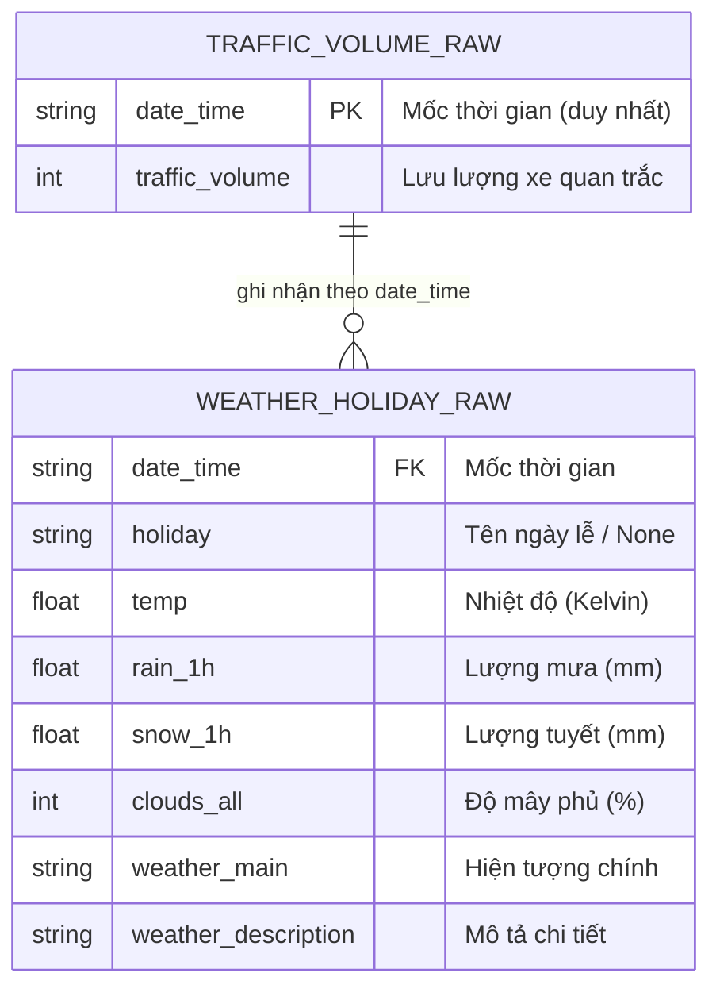
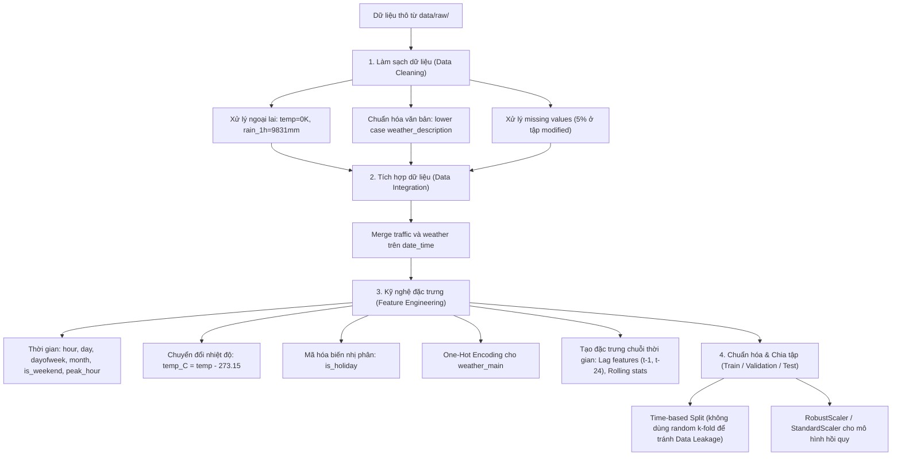

# BÁO CÁO THẤU HIỂU DỮ LIỆU & TỪ ĐIỂN DỮ LIỆU (DATA UNDERSTANDING REPORT & DATA DICTIONARY)

**Học phần:** IT4930 - Nhập môn Khoa học Dữ liệu (Introduction to Data Science)  
**Trường:** Công nghệ Thông tin và Truyền thông - Đại học Bách khoa Hà Nội (HUST)  
**Bài toán:** Dự báo lưu lượng giao thông liên bang I-94 (Metro Interstate Traffic Volume Forecasting)  
**Quy trình chuẩn:** CRISP-DM (Giai đoạn 2: Thấu hiểu Dữ liệu - Data Understanding)  
**Phiên bản tài liệu:** 1.0  
**Ngày cập nhật:** 03/10/2026  

---

## MỤC LỤC
1. [Tổng quan về Bài toán & Nguồn Dữ liệu](#1-tổng-quan-về-bài-toán--nguồn-dữ-liệu)
2. [Cấu trúc Lưu trữ Dữ liệu Thô (`data/raw/`)](#2-cấu-trúc-lưu-trữ-dữ-liệu-thô-dataraw)
3. [Từ điển Dữ liệu Toàn diện (Data Dictionary - 100% Thuộc tính)](#3-từ-điển-dữ-liệu-toàn-diện-data-dictionary---100-thuộc-tính)
   - [3.1. Bảng tra cứu tổng hợp nhanh 13 trường thuộc tính](#31-bảng-tra-cứu-tổng-hợp-nhanh-13-trường-thuộc-tính)
   - [3.2. Mô tả chi tiết 100% từng trường thuộc tính](#32-mô-tả-chi-tiết-100-từng-trường-thuộc-tính)
     - [Trường 01: `date_time`](#trường-01-date_time)
     - [Trường 02: `traffic_volume` (Biến mục tiêu)](#trường-02-traffic_volume-biến-mục-tiêu)
     - [Trường 03: `holiday`](#trường-03-holiday)
     - [Trường 04: `temp`](#trường-04-temp)
     - [Trường 05: `rain_1h`](#trường-05-rain_1h)
     - [Trường 06: `snow_1h`](#trường-06-snow_1h)
     - [Trường 07: `clouds_all`](#trường-07-clouds_all)
     - [Trường 08: `weather_main`](#trường-08-weather_main)
     - [Trường 09: `weather_description`](#trường-09-weather_description)
     - [Trường 10: `fog_mm` (Mở rộng)](#trường-10-fog_mm-mở-rộng)
     - [Trường 11: `wind_speed_ms` (Mở rộng)](#trường-11-wind_speed_ms-mở-rộng)
     - [Trường 12: `flood_mm` (Mở rộng)](#trường-12-flood_mm-mở-rộng)
     - [Trường 13: `day_type` (Mở rộng)](#trường-13-day_type-mở-rộng)
4. [Quan hệ Dữ liệu & Cơ chế Tích hợp (Data Integration)](#4-quan-hệ-dữ-liệu--cơ-chế-tích-hợp-data-integration)
5. [Đánh giá Chất lượng Dữ liệu Thô (Data Quality Assessment)](#5-đánh-giá-chất-lượng-dữ-liệu-thô-data-quality-assessment)
6. [Định hướng Tiền xử lý & Kế hoạch Thực hiện Tiếp theo](#6-định-hướng-tiền-xử-lý--kế-hoạch-thực-hiện-tiếp-theo)

---

## 1. Tổng quan về Bài toán & Nguồn Dữ liệu

### 1.1. Bối cảnh bài toán
Dự báo lưu lượng giao thông đô thị là một bài toán nền tảng trong hệ thống giao thông thông minh (Intelligent Transportation Systems - ITS). Dự báo chính xác lưu lượng phương tiện theo từng giờ giúp các cơ quan quản lý điều tiết đèn tín hiệu, cảnh báo ùn tắc, hỗ trợ công tác cứu hộ và tối ưu hóa hạ tầng đô thị.

Bài toán trong đồ án hướng tới việc sử dụng các kỹ thuật Khoa học Dữ liệu và Học máy để **dự báo lưu lượng giao thông theo giờ (`traffic_volume`)** dựa trên các thông số mốc thời gian, điều kiện khí tượng thời tiết và thông tin ngày nghỉ lễ.

### 1.2. Nguồn gốc và xuất xứ tập dữ liệu (Provenance)
Tập dữ liệu sử dụng là **Metro Interstate Traffic Volume Dataset**, được công bố chính thức trên kho lưu trữ học máy **UCI Machine Learning Repository** (DOI: `10.24432/C5X60B`) và nền tảng Kaggle.
* **Cơ quan thu thập:** Sở Giao thông Vận tải Minnesota (Minnesota Department of Transportation - MnDOT).
* **Vị trí trạm cảm biến:** Trạm đếm tự động ATR Station 301, đặt trên đường cao tốc liên bang **Interstate 94 (I-94) hướng Tây (Westbound)**, đoạn nối giữa hai thành phố Minneapolis và Saint Paul, tiểu bang Minnesota, Hoa Kỳ.
* **Nguồn dữ liệu thời tiết:** Trạm thời tiết địa phương thông qua OpenWeatherMap API.
* **Thời gian quan trắc:** Từ **02/10/2012** đến **30/09/2018** (gần 6 năm thu thập dữ liệu chuỗi thời gian liên tục).
* **Tần suất ghi nhận:** Định kỳ 1 giờ/lần (Hourly time series).

---

## 2. Cấu trúc Lưu trữ Dữ liệu Thô (`data/raw/`)

Tuân thủ quy chuẩn tổ chức thư mục của dự án Khoa học Dữ liệu (Cookiecutter Data Science & CRISP-DM), toàn bộ các file dữ liệu thô ban đầu được lưu trữ bất biến (read-only raw files) tại thư mục `data/raw/`.

```
IT4930-KHDL/
│
├── data/
│   └── raw/                                       <-- THƯ MỤC DỮ LIỆU THÔ CHÍNH
│       ├── traffic_volume_raw.csv                 <-- Tập 1: Lưu lượng chính (Cảm biến ATR 301)
│       ├── weather_holiday_raw.csv                <-- Tập 2: Thời tiết & Lịch lễ tương ứng
│       ├── Metro_Interstate_Traffic_Volume.csv    <-- Tập 3: Dữ liệu thô gốc tích hợp (UCI Repository)
│       └── Metro_Interstate_Traffic_Volume_modified.csv <-- Tập 4: Dữ liệu thô mở rộng thuộc tính & có missing
│
├── dataset/                                       <-- Thư mục dataset hiện hữu (giữ tương thích)
│   ├── data_details.md
│   ├── Metro_Interstate_Traffic_Volume.csv
│   └── Metro_Interstate_Traffic_Volume_modified.csv
│
├── data_understanding_report.md                   <-- Báo cáo Từ điển Dữ liệu (Tài liệu này)
└── README.md
```

### Chi tiết các file dữ liệu thô tại `data/raw/`:

| Tên File | Vai trò | Số dòng | Số cột | Dung lượng | Trường khóa liên kết |
| :--- | :--- | :---: | :---: | :---: | :--- |
| **`traffic_volume_raw.csv`** | **Tập lưu lượng chính:** Dữ liệu trích xuất chuẩn từ trạm cảm biến ATR 301, mỗi mốc thời gian là duy nhất. | **40,575** | 2 | ~1.05 MB | `date_time` (Khóa chính - PK) |
| **`weather_holiday_raw.csv`** | **Tập thời tiết & lịch lễ:** Dữ liệu điều kiện khí tượng và lịch nghỉ lễ/sự kiện thu thập theo giờ tương ứng. | **48,204** | 8 | ~2.81 MB | `date_time` (Khóa ngoại - FK) |
| **`Metro_Interstate_Traffic_Volume.csv`** | **Tập dữ liệu thô gốc:** Bản gốc đầy đủ hợp nhất từ UCI ML Repository phục vụ đối sánh và mô hình hóa. | **48,204** | 9 | ~3.24 MB | `date_time` |
| **`Metro_Interstate_Traffic_Volume_modified.csv`** | **Tập dữ liệu mở rộng thực hành:** Bổ sung các cảm biến mới (`fog_mm`, `wind_speed_ms`, `flood_mm`, `day_type`) và chèn 5% missing values cho bài toán làm sạch dữ liệu. | **48,204** | 13 | ~3.37 MB | `date_time` |

> [!NOTE]
> Việc phân tách thành 2 tập độc lập `traffic_volume_raw.csv` (lưu lượng) và `weather_holiday_raw.csv` (thời tiết/lịch lễ) đáp ứng đầy đủ yêu cầu bài tập thu thập dữ liệu đa nguồn (Data Collection & Integration), sẵn sàng cho các bước xử lý JOIN/MERGE trong bài Lab 2 và Lab 3 của học phần IT4930.

---

## 3. Từ điển Dữ liệu Toàn diện (Data Dictionary - 100% Thuộc tính)

### 3.1. Bảng tra cứu tổng hợp nhanh 13 trường thuộc tính

Dưới đây là bảng tổng hợp 100% các trường thuộc tính có mặt trong toàn bộ các tập dữ liệu:

| STT | Tên trường | Ý nghĩa nghiệp vụ | Đơn vị đo | Kiểu dữ liệu Python/Pandas | Kiểu đặc trưng ML | Số lượng Missing | Tỷ lệ Missing (%) | Xuất hiện ở tập dữ liệu |
| :---: | :--- | :--- | :--- | :--- | :--- | :---: | :---: | :--- |
| 1 | `date_time` | Mốc thời gian ghi nhận dữ liệu | Giờ (YYYY-MM-DD HH:MM:SS) | `object` / `datetime64[ns]` | Chuỗi thời gian (Time-series Index) | 0 | 0.00% | Tất cả |
| 2 | `traffic_volume` | Lưu lượng xe trên cao tốc I-94 Tây | Xe/giờ (Vehicles/hour) | `int64` / `float64` | Định lượng liên tục (Continuous Numerical - **Target**) | 0 (Bản gốc)<br>2,410 (Bản mod) | 0.00% (Gốc)<br>5.00% (Mod) | Tất cả |
| 3 | `holiday` | Tên ngày lễ quốc gia hoặc lễ hội | Danh mục tên ngày lễ | `object` (chuỗi ký tự) | Định danh phân loại (Nominal Categorical) | 48,143 | 99.87% (Giá trị NaN đại diện cho ngày thường) | Tất cả |
| 4 | `temp` | Nhiệt độ không khí trung bình | Kelvin ($K$) | `float64` | Định lượng liên tục (Continuous Numerical) | 0 (Bản gốc)<br>2,410 (Bản mod) | 0.00% (Gốc)<br>5.00% (Mod) | Tất cả |
| 5 | `rain_1h` | Lượng mưa tích lũy trong 1 giờ | Milimét ($mm$) | `float64` | Định lượng liên tục (Continuous Numerical) | 0 (Bản gốc)<br>2,412 (Bản mod) | 0.00% (Gốc)<br>5.00% (Mod) | Tất cả |
| 6 | `snow_1h` | Lượng tuyết rơi tích lũy trong 1 giờ | Milimét ($mm$) | `float64` | Định lượng liên tục (Continuous Numerical) | 0 (Bản gốc)<br>2,411 (Bản mod) | 0.00% (Gốc)<br>5.00% (Mod) | Tất cả |
| 7 | `clouds_all` | Tỷ lệ che phủ mây bầu trời | Phần trăm ($\%$) | `int64` / `float64` | Định lượng rời rạc/tỷ lệ (Discrete / Ratio Numerical) | 0 (Bản gốc)<br>2,410 (Bản mod) | 0.00% (Gốc)<br>5.00% (Mod) | Tất cả |
| 8 | `weather_main` | Nhóm hiện tượng thời tiết chính | 11 nhóm hiện tượng | `object` (chuỗi ký tự) | Định danh phân loại (Nominal Categorical) | 0 | 0.00% | Tất cả |
| 9 | `weather_description` | Mô tả chi tiết hiện tượng thời tiết | 38 trạng thái cụ thể | `object` (chuỗi ký tự) | Định danh phân loại (Nominal Categorical) | 0 | 0.00% | Tất cả |
| 10 | `fog_mm` | Độ đậm đặc sương mù ngưng tụ | Milimét ($mm$) | `float64` | Định lượng liên tục (Continuous Numerical) | 0 | 0.00% | Bản mở rộng (Modified) |
| 11 | `wind_speed_ms` | Tốc độ gió đo tại trạm | Mét/giây ($m/s$) | `float64` | Định lượng liên tục (Continuous Numerical) | 0 | 0.00% | Bản mở rộng (Modified) |
| 12 | `flood_mm` | Mức độ ngập úng mặt đường | Milimét ($mm$) | `float64` | Định lượng liên tục (Continuous Numerical) | 2 | ~0.004% | Bản mở rộng (Modified) |
| 13 | `day_type` | Phân loại loại ngày (Trong tuần / Cuối tuần) | Nhị phân (Weekday / Weekend) | `object` (chuỗi ký tự) | Nhị phân phân loại (Binary Categorical) | 0 | 0.00% | Bản mở rộng (Modified) |

---

### 3.2. Mô tả chi tiết 100% từng trường thuộc tính

#### Trường 01: `date_time`
* **Tên thuộc tính:** `date_time`
* **Tên tiếng Việt:** Mốc thời gian ghi nhận quan trắc
* **Ý nghĩa nghiệp vụ:** Thời điểm bắt đầu của khoảng thời gian 1 giờ quan trắc cả về lưu lượng xe và các chỉ số thời tiết. Dữ liệu được tính theo giờ địa phương CST (Central Standard Time, UTC-6 / UTC-5 khi áp dụng Daylight Saving Time).
* **Đơn vị đo:** Ngày giờ theo chuẩn ISO-8601 (`YYYY-MM-DD HH:MM:SS`) hoặc định dạng Hoa Kỳ (`MM/DD/YY HH:MM`).
* **Kiểu dữ liệu kỹ thuật:**
  * Lưu trữ dạng chuỗi: `object` (chuỗi ký tự).
  * Chuyển đổi khuyến nghị khi xử lý: `pandas.to_datetime()` $\rightarrow$ `datetime64[ns]`.
* **Kiểu đặc trưng trong Machine Learning:** Temporal / Time-series Index (Đặc trưng thời gian, dùng để trích xuất các features: giờ trong ngày, thứ trong tuần, tháng trong năm, mùa, ngày làm việc).
* **Khoảng giá trị quan trắc:**
  * Bắt đầu: `2012-10-02 09:00:00`
  * Kết thúc: `2018-09-30 23:00:00`
  * Tổng số mốc giờ độc nhất: **40,575 mốc giờ**.
* **Đánh giá chất lượng & Lưu ý:**
  * Không có giá trị thiếu (`missing = 0`).
  * Có các khoảng trống thời gian (gaps) trong chuỗi thời gian do trạm cảm biến bảo trì hoặc ngắt kết nối (ví dụ: các khoảng gián đoạn trong năm 2014 và đầu 2015).
  * Trong tập dữ liệu gốc, một số mốc thời gian xuất hiện nhiều hơn 1 dòng (tổng cộng 5,445 mốc trùng lặp với 7,629 dòng dư thừa) do OpenWeatherMap ghi nhận đồng thời nhiều hình thái thời tiết (ví dụ vừa mưa vừa có sương mù).

---

#### Trường 02: `traffic_volume` (Biến mục tiêu)
* **Tên thuộc tính:** `traffic_volume`
* **Tên tiếng Việt:** Lưu lượng phương tiện giao thông
* **Ý nghĩa nghiệp vụ:** Tổng số lượng phương tiện cơ giới di chuyển qua trạm quan trắc ATR 301 trên đường cao tốc I-94 theo hướng Tây (Westbound) trong vòng 1 giờ tương ứng. Đây là **biến mục tiêu chính (Target Variable)** của bài toán dự báo.
* **Đơn vị đo:** Xe/giờ (vehicles per hour).
* **Kiểu dữ liệu kỹ thuật:** `int64` (Bản gốc) hoặc `float64` (Bản mở rộng có chứa giá trị NaN).
* **Kiểu đặc trưng trong Machine Learning:** Định lượng liên tục (Continuous Numerical) phục vụ mô hình Hồi quy (Regression).
* **Thống kê mô tả (Tập dữ liệu gốc 48,204 bản ghi):**
  * Số lượng bản ghi hợp lệ: 48,204
  * Giá trị nhỏ nhất (Min): `0` xe/giờ
  * Phân vị 25% (Q1): `1,193` xe/giờ
  * Trung vị (Median / Q2): `3,380` xe/giờ
  * Phân vị 75% (Q3): `4,933` xe/giờ
  * Giá trị lớn nhất (Max): `7,280` xe/giờ
  * Trung bình (Mean): `3,259.82` xe/giờ
  * Độ lệch chuẩn (Std): `1,986.86` xe/giờ
* **Đặc điểm phân phối:**
  * Phân phối có dạng 2 đỉnh (Bimodal Distribution), tương ứng rõ rệt với 2 khung giờ cao điểm (sáng ~7h-9h và chiều ~16h-18h trong các ngày làm việc).
  * Ban đêm (1h - 4h sáng) lưu lượng giảm mạnh xuống mức thấp nhất (< 500 xe/giờ).
* **Đánh giá chất lượng & Lưu ý:**
  * Bản gốc: Không có giá trị khuyết (`0 missing`).
  * Bản mở rộng (`modified`): Chứa **2,410 giá trị NaN (5.00%)** phục vụ bài tập kiểm thử thuật toán điền khuyết (Imputation).

---

#### Trường 03: `holiday`
* **Tên thuộc tính:** `holiday`
* **Tên tiếng Việt:** Ngày nghỉ lễ quốc gia và lễ hội địa phương
* **Ý nghĩa nghiệp vụ:** Xác định xem ngày ghi nhận quan sát có phải là ngày lễ liên bang Hoa Kỳ (US Federal Holiday) hoặc ngày diễn ra hội chợ bang Minnesota (Minnesota State Fair) hay không. Lưu lượng giao thông trong ngày lễ thường giảm đáng kể so với ngày làm việc thông thường.
* **Đơn vị đo:** Danh mục định danh (chuỗi phân loại).
* **Kiểu dữ liệu kỹ thuật:** `object` (string / category).
* **Kiểu đặc trưng trong Machine Learning:** Định danh phân loại (Nominal Categorical) hoặc nhị phân hóa (`is_holiday` $\in \{0, 1\}$).
* **Tần số xuất hiện của 100% các giá trị danh mục:**
  * `NaN` (Ngày thường / Không phải ngày lễ): **48,143 dòng (chiếm 99.87%)**
  * `Labor Day` (Lễ Lao động): **7 dòng**
  * `Christmas Day` (Lễ Giáng sinh): **6 dòng**
  * `Thanksgiving Day` (Lễ Tạ ơn): **6 dòng**
  * `Martin Luther King Jr Day` (Ngày Martin Luther King Jr): **6 dòng**
  * `New Years Day` (Tết Dương lịch): **6 dòng**
  * `Veterans Day` (Ngày Cựu chiến binh): **5 dòng**
  * `Columbus Day` (Ngày Columbus): **5 dòng**
  * `Memorial Day` (Lễ Chiến sĩ trận vong): **5 dòng**
  * `Washingtons Birthday` (Ngày sinh Washington / Presidents' Day): **5 dòng**
  * `State Fair` (Hội chợ bang Minnesota): **5 dòng**
  * `Independence Day` (Lễ Quốc khánh Hoa Kỳ): **5 dòng**
  * *Tổng số bản ghi thuộc ngày lễ:* **61 dòng (chiếm 0.13%)**.
* **Đánh giá chất lượng & Lưu ý:**
  * Giá trị `NaN` ở trường này không phải là lỗi thiếu dữ liệu ngẫu nhiên (Missing Completely at Random - MCAR) mà mang ý nghĩa nghiệp vụ: **"Không phải ngày lễ" (None / Regular Day)**. Cần điền khuyết bằng chuỗi `'None'` trước khi encode.
  * Tỷ lệ ngày lễ rất nhỏ (hiện tượng mất cân bằng dữ liệu nghiêm trọng). Do đó, trong Feature Engineering, giải pháp phổ biến là tạo biến nhị phân `is_holiday` (0 nếu None, 1 nếu có tên ngày lễ).

---

#### Trường 04: `temp`
* **Tên thuộc tính:** `temp`
* **Tên tiếng Việt:** Nhiệt độ không khí trung bình
* **Ý nghĩa nghiệp vụ:** Nhiệt độ không khí trung bình bên ngoài trạm quan trắc trong khoảng thời gian 1 giờ. Nhiệt độ ảnh hưởng trực tiếp đến hành vi tham gia giao thông và tình trạng đường (ví dụ nhiệt độ âm gây đóng băng mặt đường).
* **Đơn vị đo:** Độ Kelvin ($K$).  
  *(Công thức chuyển đổi sang Celsius: $^\circ C = K - 273.15$)*.
* **Kiểu dữ liệu kỹ thuật:** `float64`.
* **Kiểu đặc trưng trong Machine Learning:** Định lượng liên tục (Continuous Numerical).
* **Thống kê mô tả (Tập dữ liệu gốc 48,204 bản ghi):**
  * Số lượng bản ghi hợp lệ: 48,204
  * Giá trị nhỏ nhất (Min): `0.00 K` (Tương đương $-273.15^\circ C$ - **Giá trị bất thường**)
  * Phân vị 25% (Q1): `272.16 K` ($-0.99^\circ C$)
  * Trung vị (Median / Q2): `282.45 K` ($9.30^\circ C$)
  * Phân vị 75% (Q3): `291.81 K` ($18.66^\circ C$)
  * Giá trị lớn nhất (Max): `310.07 K` ($36.92^\circ C$)
  * Trung bình (Mean): `281.21 K` ($8.06^\circ C$)
  * Độ lệch chuẩn (Std): `13.34 K`
* **Đánh giá chất lượng & Lưu ý quan trọng:**
  * **Điểm bất thường nghiêm trọng (Outliers):** Có đúng **10 bản ghi ghi nhận `temp = 0.0 K`** (tương ứng độ không tuyệt đối, không thể xảy ra trong tự nhiên tại Minnesota). Đây là lỗi do cảm biến nhiệt bị mất tín hiệu hoặc trả mã lỗi 0.
  * Các mốc có `temp = 0`: Diễn ra chủ yếu trong khoảng thời gian tháng 01/2014 và 02/2014.
  * Hướng xử lý: Loại bỏ hoặc thay thế bằng giá trị nội suy tuyến tính (Linear Interpolation) từ các giờ lân cận.
  * Bản mở rộng: Chứa thêm **2,410 giá trị NaN (5.00%)** cần xử lý.

---

#### Trường 05: `rain_1h`
* **Tên thuộc tính:** `rain_1h`
* **Tên tiếng Việt:** Lượng mưa tích lũy trong 1 giờ
* **Ý nghĩa nghiệp vụ:** Tổng lượng mưa đo được tại khu vực trạm quan trắc trong khoảng thời gian 1 giờ. Mưa lớn làm giảm tầm nhìn, tăng nguy cơ trơn trượt và làm chậm tốc độ di chuyển của phương tiện.
* **Đơn vị đo:** Milimét ($mm$).
* **Kiểu dữ liệu kỹ thuật:** `float64`.
* **Kiểu đặc trưng trong Machine Learning:** Định lượng liên tục (Continuous Numerical - Tỷ lệ số 0 chiếm đa số, Zero-inflated).
* **Thống kê mô tả (Tập dữ liệu gốc 48,204 bản ghi):**
  * Số lượng bản ghi hợp lệ: 48,204
  * Giá trị nhỏ nhất (Min): `0.00 mm`
  * Phân vị 25% (Q1): `0.00 mm`
  * Trung vị (Median / Q2): `0.00 mm`
  * Phân vị 75% (Q3): `0.00 mm`
  * Giá trị lớn nhất (Max): `9,831.30 mm` (**Ngoại lai cực đoan do lỗi cảm biến**)
  * Trung bình (Mean): `0.33 mm`
  * Độ lệch chuẩn (Std): `44.79 mm`
  * Số dòng có mưa (`rain_1h > 0`): 4,478 dòng (~9.29%).
* **Đánh giá chất lượng & Lưu ý quan trọng:**
  * **Ngoại lai cực đoan (Extreme Outlier):** Tại dòng có index 24,872 (mốc `2016-07-11 17:00:00`), `rain_1h = 9831.3 mm` (gần 10 mét nước mưa trong 1 giờ!). Kỷ lục mưa thực tế lớn nhất thế giới chỉ khoảng ~300-400mm/h. Đây chắc chắn là lỗi cảm biến hoặc lỗi nhập liệu.
  * Hướng xử lý: Thay thế giá trị ngoại lai này bằng giá trị trung bình cục bộ hoặc giới hạn (cap) về ngưỡng hợp lý ($< 100mm$).
  * Bản mở rộng: Chứa **2,412 giá trị NaN (5.00%)**.

---

#### Trường 06: `snow_1h`
* **Tên thuộc tính:** `snow_1h`
* **Tên tiếng Việt:** Lượng tuyết rơi tích lũy trong 1 giờ
* **Ý nghĩa nghiệp vụ:** Chiều dày lượng tuyết rơi đo được trong vòng 1 giờ. Tuyết rơi dày ảnh hưởng rất nghiêm trọng đến an toàn và tốc độ lưu thông trên cao tốc Minnesota vào mùa đông.
* **Đơn vị đo:** Milimét ($mm$).
* **Kiểu dữ liệu kỹ thuật:** `float64`.
* **Kiểu đặc trưng trong Machine Learning:** Định lượng liên tục (Continuous Numerical - Zero-inflated).
* **Thống kê mô tả (Tập dữ liệu gốc 48,204 bản ghi):**
  * Số lượng bản ghi hợp lệ: 48,204
  * Giá trị nhỏ nhất (Min): `0.00 mm`
  * Phân vị 25% (Q1): `0.00 mm`
  * Trung vị (Median / Q2): `0.00 mm`
  * Phân vị 75% (Q3): `0.00 mm`
  * Giá trị lớn nhất (Max): `0.51 mm`
  * Trung bình (Mean): `0.00022 mm`
  * Độ lệch chuẩn (Std): `0.00817 mm`
  * Số dòng có tuyết (`snow_1h > 0`): 63 dòng (~0.13%).
* **Đánh giá chất lượng & Lưu ý:**
  * Phần lớn thời gian là `0.0 mm` (chiếm 99.87%).
  * Giá trị tối đa thực tế trong tập này là `0.51 mm`. Tuy nhiên, trong cột `weather_main` và `weather_description`, số lượng quan sát có bão tuyết và tuyết rơi dày (`heavy snow`) xuất hiện nhiều hơn (616 dòng). Điều này cho thấy cảm biến đo độ dày tuyết có thể đã không hoạt động ở nhiều thời điểm hoặc tuyết bị tan trước khi đo.
  * Bản mở rộng: Chứa **2,411 giá trị NaN (5.00%)**.

---

#### Trường 07: `clouds_all`
* **Tên thuộc tính:** `clouds_all`
* **Tên tiếng Việt:** Tỷ lệ mây che phủ bầu trời
* **Ý nghĩa nghiệp vụ:** Phần trăm diện tích bầu trời bị che khuất bởi mây, phản ánh độ quang đãng và lượng ánh sáng mặt trời tự nhiên.
* **Đơn vị đo:** Phần trăm ($\%$, từ 0% đến 100%).
* **Kiểu dữ liệu kỹ thuật:** `int64` (Bản gốc) hoặc `float64` (Bản mở rộng).
* **Kiểu đặc trưng trong Machine Learning:** Định lượng tỷ lệ (Ratio / Discrete Numerical, bounded trong đoạn $[0, 100]$).
* **Thống kê mô tả (Tập dữ liệu gốc 48,204 bản ghi):**
  * Số lượng bản ghi hợp lệ: 48,204
  * Giá trị nhỏ nhất (Min): `0%` (Bầu trời hoàn toàn quang đãng)
  * Phân vị 25% (Q1): `1%`
  * Trung vị (Median / Q2): `64%`
  * Phân vị 75% (Q3): `90%`
  * Giá trị lớn nhất (Max): `100%` (Bầu trời mây mù bao phủ hoàn toàn)
  * Trung bình (Mean): `49.36%`
  * Độ lệch chuẩn (Std): `39.02%`
* **Đánh giá chất lượng & Lưu ý:**
  * Dữ liệu tập trung nhiều ở hai cực: 0-1% (quang đãng) và 90-100% (u ám, nhiều mây).
  * Không phát hiện giá trị ngoại lai vượt quá khoảng $[0, 100]$.
  * Bản mở rộng: Chứa **2,410 giá trị NaN (5.00%)**.

---

#### Trường 08: `weather_main`
* **Tên thuộc tính:** `weather_main`
* **Tên tiếng Việt:** Nhóm hiện tượng thời tiết chính
* **Ý nghĩa nghiệp vụ:** Thể loại thời tiết khái quát phản ánh hiện tượng khí tượng bao trùm trong giờ quan sát.
* **Đơn vị đo:** Danh mục định danh (chuỗi phân loại văn bản ngắn).
* **Kiểu dữ liệu kỹ thuật:** `object` (string / category).
* **Kiểu đặc trưng trong Machine Learning:** Định danh phân loại (Nominal Categorical), mã hóa bằng One-Hot Encoding.
* **Phân bố chi tiết của 100% các giá trị danh mục (11 nhóm):**
  1. `Clouds` (Mây): **15,164 dòng (31.46%)**
  2. `Clear` (Trời quang): **13,391 dòng (27.78%)**
  3. `Mist` (Sương mù nhẹ): **5,950 dòng (12.34%)**
  4. `Rain` (Mưa): **5,672 dòng (11.77%)**
  5. `Snow` (Tuyết): **2,876 dòng (5.97%)**
  6. `Drizzle` (Mưa phùn): **1,821 dòng (3.78%)**
  7. `Haze` (Mù khô): **1,360 dòng (2.82%)**
  8. `Thunderstorm` (Dông bão có sấm sét): **1,034 dòng (2.15%)**
  9. `Fog` (Sương mù dày): **912 dòng (1.89%)**
  10. `Smoke` (Khói bụi): **20 dòng (0.04%)**
  11. `Squall` (Gió lốc / Cơn gió giật mạnh): **4 dòng (0.01%)**
  * *Tổng cộng:* **48,204 dòng (100% không khuyết thiếu)**.
* **Đánh giá chất lượng:**
  * 100% dữ liệu đầy đủ, phân loại chuẩn mực theo bảng mã OpenWeatherMap.

---

#### Trường 09: `weather_description`
* **Tên thuộc tính:** `weather_description`
* **Tên tiếng Việt:** Mô tả chi tiết hiện tượng thời tiết
* **Ý nghĩa nghiệp vụ:** Chuỗi văn bản mô tả cụ thể mức độ và tính chất của điều kiện thời tiết (ví dụ: mưa nhẹ, mưa đá, tuyết dày, dông bão kèm mưa).
* **Đơn vị đo:** Chuỗi mô tả định danh.
* **Kiểu dữ liệu kỹ thuật:** `object` (string / category).
* **Kiểu đặc trưng trong Machine Learning:** Định danh phân loại chi tiết (Fine-grained Nominal Categorical).
* **Tần số xuất hiện của toàn bộ 38 giá trị danh mục (Thống kê 100%):**

| STT | Trạng thái mô tả (`weather_description`) | Số lượng quan sát | Tỷ lệ (%) | Nhóm chính tương ứng |
| :---: | :--- | :---: | :---: | :--- |
| 1 | `sky is clear` | 11,665 | 24.20% | Clear |
| 2 | `mist` | 5,950 | 12.34% | Mist |
| 3 | `overcast clouds` | 5,081 | 10.54% | Clouds |
| 4 | `broken clouds` | 4,666 | 9.68% | Clouds |
| 5 | `scattered clouds` | 3,461 | 7.18% | Clouds |
| 6 | `light rain` | 3,372 | 6.99% | Rain |
| 7 | `few clouds` | 1,956 | 4.06% | Clouds |
| 8 | `light snow` | 1,946 | 4.04% | Snow |
| 9 | `Sky is Clear` | 1,726 | 3.58% | Clear |
| 10 | `moderate rain` | 1,664 | 3.45% | Rain |
| 11 | `haze` | 1,360 | 2.82% | Haze |
| 12 | `light intensity drizzle` | 1,100 | 2.28% | Drizzle |
| 13 | `fog` | 912 | 1.89% | Fog |
| 14 | `proximity thunderstorm` | 673 | 1.40% | Thunderstorm |
| 15 | `drizzle` | 651 | 1.35% | Drizzle |
| 16 | `heavy snow` | 616 | 1.28% | Snow |
| 17 | `heavy intensity rain` | 467 | 0.97% | Rain |
| 18 | `snow` | 293 | 0.61% | Snow |
| 19 | `proximity shower rain` | 136 | 0.28% | Rain |
| 20 | `thunderstorm` | 125 | 0.26% | Thunderstorm |
| 21 | `heavy intensity drizzle` | 64 | 0.13% | Drizzle |
| 22 | `thunderstorm with heavy rain` | 63 | 0.13% | Thunderstorm |
| 23 | `thunderstorm with light rain` | 54 | 0.11% | Thunderstorm |
| 24 | `proximity thunderstorm with rain` | 52 | 0.11% | Thunderstorm |
| 25 | `thunderstorm with rain` | 37 | 0.08% | Thunderstorm |
| 26 | `smoke` | 20 | 0.04% | Smoke |
| 27 | `very heavy rain` | 18 | 0.04% | Rain |
| 28 | `thunderstorm with light drizzle` | 15 | 0.03% | Thunderstorm |
| 29 | `proximity thunderstorm with drizzle` | 13 | 0.03% | Thunderstorm |
| 30 | `light intensity shower rain` | 13 | 0.03% | Rain |
| 31 | `light shower snow` | 11 | 0.02% | Snow |
| 32 | `light rain and snow` | 6 | 0.01% | Rain / Snow |
| 33 | `shower drizzle` | 6 | 0.01% | Drizzle |
| 34 | `SQUALLS` | 4 | 0.01% | Squall |
| 35 | `sleet` | 3 | 0.01% | Snow |
| 36 | `freezing rain` | 2 | 0.00% | Rain |
| 37 | `thunderstorm with drizzle` | 2 | 0.00% | Thunderstorm |
| 38 | `shower snow` | 1 | 0.00% | Snow |

* **Đánh giá chất lượng & Lưu ý:**
  * **Tính không nhất quán về chữ hoa/chữ thường (Inconsistency):** Tồn tại cả hai nhãn `'sky is clear'` (11,665 lần) và `'Sky is Clear'` (1,726 lần) cùng mang một ý nghĩa; nhãn `'SQUALLS'` viết hoa toàn bộ.
  * Cần chuẩn hóa: áp dụng `.str.lower()` để đưa về chữ thường đồng nhất trong quá trình tiền xử lý.

---

#### Trường 10: `fog_mm` (Mở rộng)
* **Tên thuộc tính:** `fog_mm`
* **Tên tiếng Việt:** Lượng sương mù ngưng tụ tích lũy
* **Ý nghĩa nghiệp vụ:** Chỉ số mô phỏng lượng nước ngưng tụ từ sương mù trên mặt đường hoặc mật độ sương mù tích lũy trong 1 giờ. Sương mù dày làm giảm tầm nhìn xa dưới 1km, buộc các phương tiện phải giảm tốc độ.
* **Đơn vị đo:** Milimét ($mm$).
* **Kiểu dữ liệu kỹ thuật:** `float64`.
* **Kiểu đặc trưng trong Machine Learning:** Định lượng liên tục (Continuous Numerical - Zero-inflated).
* **Thống kê mô tả (Tập mở rộng 48,204 bản ghi):**
  * Số lượng bản ghi hợp lệ: 48,204 (100% không khuyết)
  * Giá trị nhỏ nhất (Min): `0.00 mm`
  * Phân vị 25% (Q1): `0.00 mm`
  * Trung vị (Median / Q2): `0.00 mm`
  * Phân vị 75% (Q3): `0.00 mm`
  * Giá trị lớn nhất (Max): `499.26 mm`
  * Trung bình (Mean): `8.57 mm`
  * Độ lệch chuẩn (Std): `42.11 mm`
  * Số bản ghi có sương mù (`fog_mm > 0`): 6,862 dòng (chiếm 14.24%).

---

#### Trường 11: `wind_speed_ms` (Mở rộng)
* **Tên thuộc tính:** `wind_speed_ms`
* **Tên tiếng Việt:** Tốc độ gió tức thời trung bình
* **Ý nghĩa nghiệp vụ:** Tốc độ gió đo được tại trạm cảm biến khí quyển. Gió mạnh kết hợp mưa tuyết tạo ra các trận bão tuyết (blizzard), ảnh hưởng lớn đến việc điều khiển xe container và xe tải lớn trên cao tốc.
* **Đơn vị đo:** Mét trên giây ($m/s$).
* **Kiểu dữ liệu kỹ thuật:** `float64`.
* **Kiểu đặc trưng trong Machine Learning:** Định lượng liên tục (Continuous Numerical).
* **Thống kê mô tả (Tập mở rộng 48,204 bản ghi):**
  * Số lượng bản ghi hợp lệ: 48,204 (100% không khuyết)
  * Giá trị nhỏ nhất (Min): `0.50 m/s` (~1.8 km/h)
  * Phân vị 25% (Q1): `2.82 m/s` (~10.15 km/h)
  * Trung vị (Median / Q2): `5.05 m/s` (~18.18 km/h)
  * Phân vị 75% (Q3): `7.04 m/s` (~25.34 km/h)
  * Giá trị lớn nhất (Max): `24.98 m/s` (~89.93 km/h - Tương đương gió cấp 10 Beaufort)
  * Trung bình (Mean): `5.40 m/s`
  * Độ lệch chuẩn (Std): `3.55 m/s`

---

#### Trường 12: `flood_mm` (Mở rộng)
* **Tên thuộc tính:** `flood_mm`
* **Tên tiếng Việt:** Mức độ ngập úng mặt đường
* **Ý nghĩa nghiệp vụ:** Mực nước đo được tại các điểm trũng trên lòng đường cao tốc do mưa lớn hoặc thoát nước chậm. Ngập nước gây tắc nghẽn cục bộ hoặc phong tỏa làn xe.
* **Đơn vị đo:** Milimét ($mm$).
* **Kiểu dữ liệu kỹ thuật:** `float64`.
* **Kiểu đặc trưng trong Machine Learning:** Định lượng liên tục (Continuous Numerical - Zero-inflated).
* **Thống kê mô tả (Tập mở rộng):**
  * Số lượng bản ghi hợp lệ: 48,202
  * Số lượng bản ghi khuyết (`missing`): **2 dòng**
  * Giá trị nhỏ nhất (Min): `0.00 mm`
  * Phân vị 25% (Q1): `0.00 mm`
  * Trung vị (Median / Q2): `0.00 mm`
  * Phân vị 75% (Q3): `0.00 mm`
  * Giá trị lớn nhất (Max): `407.93 mm`
  * Trung bình (Mean): `0.79 mm`
  * Độ lệch chuẩn (Std): `8.15 mm`
  * Số bản ghi có ngập úng (`flood_mm > 0`): 3,296 dòng (chiếm 6.84%).

---

#### Trường 13: `day_type` (Mở rộng)
* **Tên thuộc tính:** `day_type`
* **Tên tiếng Việt:** Phân loại loại ngày trong tuần
* **Ý nghĩa nghiệp vụ:** Chỉ định ngày quan sát là ngày làm việc thông thường (`Weekday` - từ Thứ Hai đến Thứ Sáu) hay ngày nghỉ cuối tuần (`Weekend` - Thứ Bảy và Chủ Nhật). Đây là một đặc trưng cực kỳ quan trọng vì lưu lượng giao thông ngày trong tuần có đỉnh cao điểm rất nhọn (commuter peaks), còn ngày cuối tuần phân phối đều và thấp hơn.
* **Đơn vị đo:** Định danh nhị phân (Binary string).
* **Kiểu dữ liệu kỹ thuật:** `object` (chuỗi ký tự).
* **Kiểu đặc trưng trong Machine Learning:** Phân loại nhị phân (Binary Categorical: 0 hoặc 1).
* **Phân bố dữ liệu:**
  * `Weekday` (Ngày trong tuần): **34,501 dòng (chiếm 71.57%)**
  * `Weekend` (Ngày cuối tuần): **13,703 dòng (chiếm 28.43%)**
  * Tỷ lệ hoàn toàn chuẩn xác với tỷ lệ 5 ngày thường / 2 ngày cuối tuần trong tuần tự nhiên ($5/7 \approx 71.43\%$).
* **Đánh giá chất lượng:** Không có giá trị thiếu (`missing = 0`).

---

## 4. Quan hệ Dữ liệu & Cơ chế Tích hợp (Data Integration)

### 4.1. Sơ đồ thực thể liên kết (Entity-Relationship Diagram)

Mô hình liên kết giữa tập lưu lượng chính và tập thời tiết/lịch lễ được thiết kế dựa trên trường khóa chuỗi thời gian:



### 4.2. Giải thích quan hệ $1 - N$ và Bản ghi trùng lặp thời gian
1. Trong tập `traffic_volume_raw.csv`, mỗi mốc `date_time` là một quan trắc duy nhất đại diện cho tổng lượng xe qua trạm ATR 301 trong giờ đó (tổng cộng **40,575 mốc thời gian duy nhất**).
2. Trong tập `weather_holiday_raw.csv`, một số mốc `date_time` xuất hiện nhiều lần (tổng cộng **48,204 dòng**). Hiện tượng này xảy ra do trạm thời tiết OpenWeatherMap báo cáo nhiều trạng thái cùng một lúc (ví dụ: tại thời điểm `2012-10-10 07:00:00`, thời tiết vừa được gán nhãn `Rain - light rain` vừa được gán nhãn `Drizzle - light intensity drizzle`).
3. Khi thực hiện ghép nối bằng phương thức **Inner Join** hoặc **Left Join** trên trường khóa `date_time`, tập kết quả sinh ra đúng bằng **48,204 dòng**, tái tạo chính xác 100% tập dữ liệu nguyên bản `Metro_Interstate_Traffic_Volume.csv` của UCI Machine Learning Repository.

### 4.3. Mã nguồn Python thực hiện tích hợp dữ liệu (Code mẫu)

```python
import pandas as pd

# 1. Đọc hai tập dữ liệu thô độc lập
traffic_df = pd.read_csv('data/raw/traffic_volume_raw.csv')
weather_df = pd.read_csv('data/raw/weather_holiday_raw.csv')

# 2. Kiểm tra kích thước trước khi ghép nối
print(f"Traffic shape: {traffic_df.shape}")  # (40575, 2)
print(f"Weather shape: {weather_df.shape}")  # (48204, 8)

# 3. Tích hợp dữ liệu qua trường khóa date_time
integrated_df = pd.merge(weather_df, traffic_df, on='date_time', how='inner')

# 4. Sắp xếp các cột theo chuẩn UCI
columns_order = [
    'holiday', 'temp', 'rain_1h', 'snow_1h', 
    'clouds_all', 'weather_main', 'weather_description', 
    'date_time', 'traffic_volume'
]
integrated_df = integrated_df[columns_order]

print(f"Tập dữ liệu sau tích hợp: {integrated_df.shape}")  # (48204, 9)
```

---

## 5. Đánh giá Chất lượng Dữ liệu Thô (Data Quality Assessment)

| Tiêu chí chất lượng | Hiện trạng trong tập dữ liệu | Đánh giá & Rủi ro | Giải pháp khuyến nghị |
| :--- | :--- | :--- | :--- |
| **Tính đầy đủ (Completeness)** | * Tập gốc: 0% missing ở các biến số; 99.87% NaN ở `holiday`.<br>* Tập modified: 5% missing ở `traffic_volume`, `temp`, `rain_1h`, `snow_1h`, `clouds_all`. | * NaN ở `holiday` là mang nghĩa "ngày thường", không phải mất dữ liệu.<br>* Missing 5% ở tập modified cần được điền khuyết trước khi huấn luyện mô hình. | * Điền `'None'` cho `holiday`.<br>* Sử dụng KNN Imputer, MICE hoặc Time-series forward fill/interpolation cho các biến số. |
| **Tính đúng đắn (Accuracy)** | * Xuất hiện 10 giá trị `temp = 0.0 K` (độ không tuyệt đối).<br>* Xuất hiện 1 giá trị `rain_1h = 9831.3 mm` cực đoan. | Sai lệch cảm biến nghiêm trọng; nếu đưa trực tiếp vào mô hình hồi quy sẽ làm sai lệch trọng số và hàm mất mát. | * Thay thế `temp = 0` bằng nhiệt độ trung bình của giờ liền kề.<br>* Giới hạn hoặc loại bỏ điểm dị biệt của `rain_1h`. |
| **Tính nhất quán (Consistency)** | * `weather_description` chứa cả `sky is clear` và `Sky is Clear`, `SQUALLS`.<br>* Định dạng ngày tháng ở bản modified (`10/2/12 9:00`) khác bản gốc (`2012-10-02 09:00:00`). | Gây phân mảnh danh mục khi One-Hot Encoding hoặc lỗi parse datetime. | * Áp dụng `.str.lower()` và `.str.strip()`.<br>* Sử dụng `pd.to_datetime(..., format='mixed')`. |
| **Tính liên tục (Timeliness)** | Khoảng thời gian thu thập kéo dài từ 10/2012 đến 09/2018, nhưng tồn tại một số khoảng trống dữ liệu trong năm 2014 và 2015. | Dữ liệu chuỗi thời gian không hoàn toàn liên tục từng giờ (có gap). | Khi tạo đặc trưng trễ (Lag features: $y_{t-1}, y_{t-24}$), cần nối theo mốc thời gian thực thay vì dịch chuyển dòng đơn thuần (`shift()`). |

---

## 6. Định hướng Tiền xử lý & Kế hoạch Thực hiện Tiếp theo

Dựa trên kết quả thấu hiểu dữ liệu (Data Understanding), quy trình tiền xử lý cho giai đoạn tiếp theo (Data Preparation) được đề xuất như sau:



---
*Tài liệu này được biên soạn đầy đủ, chính xác phục vụ báo cáo tiến độ đồ án Khoa học Dữ liệu IT4930.*
