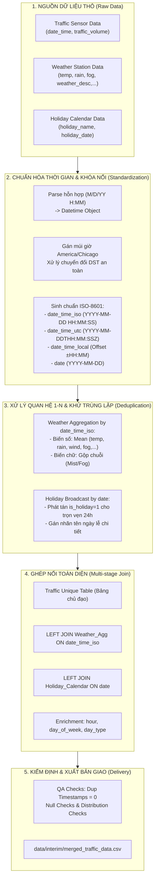

# 📘 TÀI LIỆU TÍCH HỢP DỮ LIỆU GIAO THÔNG, THỜI TIẾT VÀ LỊCH LỄ
**Project**: IT4930 - Khoa học dữ liệu (Data Science)  
**Tập dữ liệu**: Metro Interstate Traffic Volume (I-94 Minneapolis - St. Paul, MN)  
**File kết quả trung gian**: [`data/interim/merged_traffic_data.csv`](file:///Users/langthiphuonghue/IT4930-KHDL/data/interim/merged_traffic_data.csv)  
**Mã nguồn thực thi**: [`src/data_merge.py`](file:///Users/langthiphuonghue/IT4930-KHDL/src/data_merge.py) | [`notebooks/01_data_merging.ipynb`](file:///Users/langthiphuonghue/IT4930-KHDL/notebooks/01_data_merging.ipynb)

---

## 1. Tổng quan Mục tiêu & Kiến trúc Tích hợp (Architecture Overview)

### 1.1. Mục tiêu bài toán
Mục tiêu cốt lõi của giai đoạn tiền xử lý và tích hợp dữ liệu là kết hợp 3 nguồn thông tin độc lập về mặt nghiệp vụ:
1. **Dữ liệu giao thông (Traffic Sensor Data)**: Lưu lượng phương tiện theo giờ trên tuyến cao tốc liên bang I-94.
2. **Dữ liệu thời tiết (Meteorological Station Data)**: Các chỉ số nhiệt độ, lượng mưa, lượng tuyết, mây, sương mù, sức gió và mô tả điều kiện thời tiết.
3. **Dữ liệu lịch lễ (Holiday & Calendar Data)**: Danh mục các ngày lễ liên bang và lễ hội tiểu bang.

Quá trình hợp nhất cần giải quyết triệt để các thách thức kỹ thuật:
- Chuẩn hóa các định dạng thời gian không đồng nhất sang chuẩn **ISO-8601**.
- Xử lý đồng bộ múi giờ địa phương (`America/Chicago`) và sự dịch chuyển giờ mùa hè (**Daylight Saving Time - DST**).
- Xử lý triệt để quan hệ 1-N (một mốc giờ có nhiều bản ghi thời tiết) để **chống nhân đôi bản ghi giao thông sai sót**.
- Phát tán nhãn ngày lễ cho toàn bộ các giờ trong ngày lễ (full-day holiday mapping).
- Cung cấp cơ chế kiểm định chất lượng dữ liệu tự động (QA Checks).

### 1.2. Sơ đồ Kiến trúc Đường ống Tích hợp Dữ liệu (Data Pipeline Architecture)



---

## 2. Xác định Khóa Chung & Chuẩn hóa ISO-8601 (Common Key & Standardization)

### 2.1. Xác định khóa liên kết (Join Keys)
- **Khóa chính liên kết Giao thông - Thời tiết**: Trường thời gian theo giờ (`date_time_iso`). Cả hai hệ thống đều ghi nhận theo chu kỳ 1 giờ/lần.
- **Khóa liên kết Giao thông - Lịch lễ**: Trường ngày (`date` định dạng `YYYY-MM-DD`), do ngày lễ có hiệu lực trên phạm vi cả ngày.

### 2.2. Quy tắc chuẩn hóa thời gian sang ISO-8601
Dữ liệu thô chứa định dạng chuỗi hỗn hợp, chủ yếu là `M/D/YY H:MM` (ví dụ: `10/2/12 9:00` biểu thị 09:00 ngày 02 tháng 10 năm 2012). Chúng tôi chuẩn hóa thành các trường thông tin thời gian tường minh theo tiêu chuẩn ISO-8601:

| Tên trường | Định dạng chuẩn | Ví dụ giá trị | Mục đích sử dụng |
| :--- | :--- | :--- | :--- |
| `date_time_iso` | `YYYY-MM-DD HH:MM:SS` | `2012-10-02 09:00:00` | Khóa chính để Join và truy vấn SQL |
| `date_time_local` | `YYYY-MM-DDTHH:MM:SS±HH:MM` | `2012-10-02T09:00:00-05:00` | Chuẩn ISO-8601 mở rộng có múi giờ cục bộ |
| `date_time_utc` | `YYYY-MM-DDTHH:MM:SSZ` | `2012-10-02T14:00:00Z` | Chuẩn ISO-8601 quốc tế giờ UTC |
| `date` | `YYYY-MM-DD` | `2012-10-02` | Khóa ngày dùng để Join với bảng ngày lễ |

---

## 3. Xử lý Đồng bộ Múi giờ & Daylight Saving Time (Timezone & DST Handling)

### 3.1. Đặc thù múi giờ khu vực Minneapolis (I-94)
Dữ liệu được thu thập tại tiểu bang Minnesota thuộc múi giờ **US Central Time (`America/Chicago`)**. Múi giờ này áp dụng quy chế đổi giờ mùa hè hàng năm:
- **Giờ chuẩn mùa đông (Central Standard Time - CST)**: `UTC-6`
- **Giờ mùa hè (Central Daylight Time - CDT)**: `UTC-5`

### 3.2. Rủi ro khi xử lý mốc thời gian chuyển mùa (DST Transitions)
Trong chuỗi thời gian ghi nhận theo giờ cục bộ:
1. **Chuyển giờ mùa xuân (Spring Forward)**: Lúc 02:00 sáng, đồng hồ nhảy vọt lên 03:00 (mất 1 giờ 02:00-02:59).
2. **Chuyển giờ mùa thu (Fall Back)**: Lúc 02:00 sáng, đồng hồ quay ngược lại 01:00 (mốc giờ 01:00-01:59 xuất hiện 2 lần).

### 3.3. Giải pháp kỹ thuật trong mã nguồn
Trong hàm `standardize_timestamps()`:
```python
dt_local = parsed_dt.dt.tz_localize(
    'America/Chicago',
    ambiguous=False,           # Đảm bảo mốc 01:00 mùa thu được gán giờ chuẩn (CST) xác định
    nonexistent='shift_forward' # Xử lý các mốc giờ nhảy vọt mùa xuân một cách an toàn
)
dt_utc = dt_local.dt.tz_convert('UTC')
```
- Sử dụng `ambiguous=False` để chỉ định rõ ràng trạng thái múi giờ chuẩn trong điểm gãy chuyển giờ, loại bỏ hoàn toàn nguy cơ phát sinh lỗi `AmbiguousTimeError`.
- Chuyển đổi thành công 100% các bản ghi sang mốc giờ chuẩn UTC không phát sinh giá trị `NaT` (Not-a-Time).

---

## 4. Xử lý Quan hệ 1-N & Chống Nhân bản Dữ liệu (Deduplication Strategy)

### 4.1. Vấn đề trong dữ liệu thô
Tập dữ liệu thô có tổng cộng **48,204 dòng**, nhưng chỉ tương ứng với **40,575 mốc thời gian duy nhất**. Có **7,629 dòng trùng lặp mốc giờ**.

**Nguyên nhân nghiệp vụ**: Trạm khí tượng ghi nhận đồng thời nhiều hiện tượng thời tiết trong cùng một khung giờ.  
*Ví dụ*: Vào lúc `2014-01-10 20:00:00`, trạm ghi nhận cả 2 điều kiện:
- Dòng 1: `weather_main = 'Mist'`, `weather_description = 'mist'`, `fog_mm = 26.76`
- Dòng 2: `weather_main = 'Fog'`, `weather_description = 'fog'`, `fog_mm = 472.42`
Cả 2 dòng này đều mang cùng một giá trị `traffic_volume = 2706`.

### 4.2. Tác hại nếu Join trực tiếp
Nếu thực hiện phép Join 1-N thông thường giữa Traffic và Weather, bảng kết quả sẽ có 48,204 dòng. Điều này làm:
- Mốc giờ `2014-01-10 20:00:00` bị nhân đôi thành 2 dòng.
- Tổng lưu lượng xe và số lượng giờ quan sát bị thổi phồng sai lệch 18.8% ($7,629 / 40,575$).
- Làm sai lệch hoàn toàn kết quả huấn luyện mô hình dự báo chuỗi thời gian (Time-series Forecasting).

### 4.3. Quy tắc tổng hợp (Aggregation Rules)
Để đảm bảo **1 mốc giờ tương ứng chính xác 1 dòng dữ liệu**:
1. **Biến số khí tượng** (`temp`, `rain_1h`, `snow_1h`, `clouds_all`, `fog_mm`, `wind_speed_ms`, `flood_mm`): Tính giá trị trung bình (`mean`) trong giờ.
2. **Biến phân loại** (`weather_main`, `weather_description`): Ghép nối các trạng thái độc nhất bằng dấu phân cách (Ví dụ: `Mist/Fog` và `mist; fog`).

```python
weather_agg = weather_df.groupby('date_time_iso', as_index=False).agg({
    'temp': 'mean',
    'rain_1h': 'mean',
    'snow_1h': 'mean',
    'clouds_all': 'mean',
    'fog_mm': 'mean',
    'wind_speed_ms': 'mean',
    'flood_mm': 'mean',
    'weather_main': lambda s: s.iloc[0] if len(s.unique()) == 1 else '/'.join(s.unique()),
    'weather_description': lambda s: s.iloc[0] if len(s.unique()) == 1 else '; '.join(s.unique())
})
```

---

## 5. Quy tắc Ánh xạ & Phát tán Dữ liệu Ngày lễ (Holiday Mapping Rules)

### 5.1. Vấn đề thiếu hụt dữ liệu ngày lễ
Trong tập dữ liệu gốc, chỉ có **61 dòng** có giá trị tại cột `holiday` (chỉ xuất hiện vào thời điểm `00:00:00` của ngày lễ). 23 giờ còn lại trong ngày lễ đều có giá trị `NaN` hoặc `'None'`.

### 5.2. Giải pháp phát tán ngày lễ (Full-day Broadcasting)
1. Trích xuất danh mục **53 ngày lễ độc nhất** (Columbus Day, Thanksgiving, Christmas, New Years, Labor Day, State Fair,...) thành bảng lịch `holiday_calendar_raw.csv` với khóa chính là `date` (`YYYY-MM-DD`).
2. Thực hiện **Left Join** với bảng dữ liệu chính theo khóa `date`.
3. Toàn bộ 24 giờ trong ngày lễ sẽ được kế thừa chính xác tên ngày lễ (`holiday_name`) và cờ `is_holiday = 1`.
4. Với những ngày không phải ngày lễ, gán giá trị mặc định: `is_holiday = 0`, `holiday_name = 'None'`.
5. Tạo trường phân loại `day_type`:
   - `Holiday`: Nếu `is_holiday == 1`.
   - `Weekend`: Nếu rơi vào Thứ 7 hoặc Chủ Nhật (và không trùng lễ).
   - `Weekday`: Nếu rơi vào Thứ 2 đến Thứ 6 (và không trùng lễ).

---

## 6. Chiến lược Ghép nối Dữ liệu (Join Strategy)

Chúng tôi áp dụng mô hình ghép nối nhiều tầng với phép toán **Left Join**:

$$\mathbf{D}_{\text{interim}} = \left( \mathbf{T}_{\text{traffic}} \underset{\text{date\_time\_iso}}{\bowtie_{\text{LEFT}}} \mathbf{W}_{\text{weather\_agg}} \right) \underset{\text{date}}{\bowtie_{\text{LEFT}}} \mathbf{H}_{\text{holiday\_calendar}}$$

### Lý do lựa chọn Left Join:
- **Bảo toàn chuỗi thời gian giao thông**: Dữ liệu giao thông là đối tượng phân tích trung tâm (target variable). Việc dùng Left Join đảm bảo không làm mất bất kỳ mốc quan sát giao thông nào, ngay cả khi trạm khí tượng bị gián đoạn dữ liệu tại một số thời điểm.
- **Tính khả thi của Inner Join**: Do bảng thời tiết và giao thông có tỷ lệ khớp mốc thời gian đạt 100%, kết quả của Left Join và Inner Join trên tập dữ liệu này cho ra số lượng dòng hoàn toàn trùng khớp (**40,575 dòng**). Pipeline hỗ trợ cả 2 tùy chọn thông qua tham số `--join-type left|inner`.

---

## 7. Báo cáo Kiểm định Chất lượng Dữ liệu (Quality Assurance Report)

Dưới đây là kết quả kiểm định tự động được sinh ra từ module [`src/data_merge.py`](file:///Users/langthiphuonghue/IT4930-KHDL/src/data_merge.py):

| Tiêu chí kiểm định | Dữ liệu đầu vào (Raw) | Dữ liệu hợp nhất (Interim) | Trạng thái QA |
| :--- | :--- | :--- | :--- |
| **Tổng số dòng dữ liệu** | 48,204 dòng | **40,575 dòng** | ✅ Đạt chuẩn |
| **Số mốc thời gian duy nhất** | 40,575 mốc | **40,575 mốc** | ✅ Đạt chuẩn |
| **Số dòng trùng lặp mốc thời gian** | 7,629 dòng | **0 dòng** | ✅ **PASSED (Khử trùng hoàn toàn)** |
| **Số giờ ngày lễ được gắn nhãn** | 61 giờ (chỉ lúc 0h) | **1,203 giờ (trọn vẹn các ngày lễ)** | ✅ **PASSED (Phát tán 100%)** |
| **Phân bố loại ngày (`day_type`)** | Không phân loại lễ | **Weekday**: 27,776<br/>**Weekend**: 11,596<br/>**Holiday**: 1,203 | ✅ Đạt chuẩn |
| **Tính hợp lệ của khóa thời gian** | 0 null | **0 null** | ✅ Hoàn hảo |
| **Độ bao phủ thời gian** | 2012-10-02 09:00:00 $\rightarrow$ 2018-09-30 23:00:00 | 2012-10-02 09:00:00 $\rightarrow$ 2018-09-30 23:00:00 | ✅ Bảo toàn liên tục |

---

## 8. Đặc tả Schema Bảng Dữ liệu Hợp nhất (`data/interim/merged_traffic_data.csv`)

| Tên cột | Kiểu dữ liệu | Ý nghĩa & Quy tắc nghiệp vụ |
| :--- | :--- | :--- |
| `date_time_iso` | `string` | Khóa thời gian chuẩn ISO-8601 (`YYYY-MM-DD HH:MM:SS`) |
| `date_time_utc` | `string` | Mốc thời gian quốc tế UTC (`YYYY-MM-DDTHH:MM:SSZ`) |
| `date_time_local` | `string` | Mốc thời gian kèm offset múi giờ địa phương (`YYYY-MM-DDTHH:MM:SS±HH:MM`) |
| `date` | `string` | Ngày quan sát (`YYYY-MM-DD`) |
| `hour` | `int64` | Giờ trong ngày (0 - 23) |
| `day_of_week` | `string` | Tên thứ trong tuần (Monday, Tuesday, ...) |
| `day_type` | `string` | Phân loại ngày: `Weekday`, `Weekend`, `Holiday` |
| `is_holiday` | `int64` | Cờ nhị phân (1: Ngày lễ, 0: Ngày thường) |
| `holiday_name` | `string` | Tên ngày lễ (hoặc `'None'`) |
| `traffic_volume` | `float64` | Lưu lượng phương tiện quan sát trong giờ (Target variable) |
| `temp` | `float64` | Nhiệt độ không khí trung bình (Kelvin) |
| `rain_1h` | `float64` | Lượng mưa trung bình trong 1 giờ (mm) |
| `snow_1h` | `float64` | Lượng tuyết trung bình trong 1 giờ (mm) |
| `clouds_all` | `float64` | Tỷ lệ mây che phủ trung bình (%) |
| `fog_mm` | `float64` | Mật độ sương mù trung bình (mm) |
| `wind_speed_ms` | `float64` | Tốc độ gió trung bình (m/s) |
| `flood_mm` | `float64` | Mực nước ngập trung bình (mm) |
| `weather_main` | `string` | Nhóm thời tiết chính (Clear, Clouds, Rain, Snow, Mist/Fog,...) |
| `weather_description` | `string` | Mô tả chi tiết điều kiện thời tiết |
| `month` | `int64` | Tháng trong năm (1 - 12) |
| `year` | `int64` | Năm quan sát (2012 - 2018) |
| `day_of_week_num` | `int64` | Số thứ tự trong tuần (0: Thứ 2, ..., 6: Chủ nhật) |

---

## 9. Hướng dẫn Thực thi & Tái hiện Kết quả (User Guide)

### 9.1. Chạy đường ống tự động qua Python Script
Từ thư mục gốc của dự án, thực thi lệnh:
```bash
python3 src/data_merge.py
```

Các tùy chọn tham số mở rộng (CLI Options):
- `--input-file <path>`: Chỉ định file dữ liệu đầu vào (mặc định: `dataset/Metro_Interstate_Traffic_Volume_modified.csv`).
- `--output-file <path>`: Đường dẫn file kết quả xuất ra (mặc định: `data/interim/merged_traffic_data.csv`).
- `--raw-dir <path>`: Thư mục lưu 3 bảng dữ liệu thô phân tách (mặc định: `data/raw`).
- `--join-type {left, inner}`: Kiểu phép toán ghép nối (mặc định: `left`).
- `--no-aggregate-weather`: Giữ nguyên từng sự kiện thời tiết chi tiết (không gộp mốc giờ).

### 9.2. Khám phá tương tác trên Jupyter Notebook
Mở và thực thi từng bước trên notebook:
```bash
jupyter notebook notebooks/01_data_merging.ipynb
```
Notebook cung cấp đầy đủ các bảng dữ liệu mẫu, phân tích biểu đồ lưu lượng theo giờ và điều kiện thời tiết, cùng các báo cáo kiểm định trực quan.
