# 📘 TÀI LIỆU TIỀN XỬ LÝ, LỌC RÁC VÀ LÀM SẠCH DỮ LIỆU GỘP (DATA PREPROCESSING DOCUMENT)
**Project**: IT4930 - Khoa học dữ liệu (Data Science)  
**Tập dữ liệu**: Metro Interstate Traffic Volume (I-94 Minneapolis - St. Paul, MN)  
**Thành viên thực hiện**: Quỳnh Anh (TECH-01) - **Mã công việc (Task ID)**: SP1-T3  
**Dữ liệu đầu vào**: [`data/interim/merged_traffic_data.csv`](file:///c:/Users/Admin/Documents/KHDL/IT4930-KHDL/data/interim/merged_traffic_data.csv) (Kết quả từ task SP1-T2)  
**File dữ liệu chuẩn sạch**: [`data/processed/clean_traffic_data.csv`](file:///c:/Users/Admin/Documents/KHDL/IT4930-KHDL/data/processed/clean_traffic_data.csv)  
**Mã nguồn thực thi**: [`src/data_cleaning.py`](file:///c:/Users/Admin/Documents/KHDL/IT4930-KHDL/src/data_cleaning.py) | [`notebooks/02_data_cleaning.ipynb`](file:///c:/Users/Admin/Documents/KHDL/IT4930-KHDL/notebooks/02_data_cleaning.ipynb)  

---

## 1. Tổng quan Mục tiêu & Kiến trúc Tiền xử lý (Preprocessing Architecture)

### 1.1. Mục tiêu kỹ thuật
Sau khi hoàn thành tích hợp dữ liệu từ 3 nguồn (Giao thông, Thời tiết, Lịch lễ) ở giai đoạn SP1-T2, tập dữ liệu gộp trung gian vẫn còn tồn tại các rủi ro chất lượng dữ liệu:
1. **Dư thừa thuộc tính**: Các cột thời gian định dạng thô chưa chuẩn hóa (`date_time_raw`, `date_time`) gây lãng phí bộ nhớ và trùng lặp khóa chính.
2. **Ngoại lai vật lý (Physical Outliers / Infeasible Values)**: Các giá trị phi thực tế xuất hiện do lỗi cảm biến (Sensor Glitches) hoặc mất tín hiệu đường truyền viễn thông:
   - Nhiệt độ bằng $0\text{ K}$ (Độ không tuyệt đối $-273.15^\circ\text{C}$).
   - Lượng mưa cực đại đạt $9,831.3\text{ mm/h}$ (gần 10 mét nước chỉ trong một giờ).
   - Lưu lượng xe sụt giảm về $0\text{ xe/h}$ vào khung giờ cao điểm / tối thứ 7 trên tuyến cao tốc liên bang I-94.
3. **Dữ liệu khuyết thiếu (Missing / NaN Values)**: Có tổng cộng hơn $48,000$ giá trị khuyết thiếu trên các biến quan sát liên tục và phân loại cần được bù khuyết chuẩn xác theo đặc thù chuỗi thời gian (Time-series).

### 1.2. Sơ đồ Kiến trúc Đường ống Tiền xử lý Dữ liệu (Data Cleaning Pipeline)

```mermaid
flowchart TD
    subgraph Input["1. DỮ LIỆU ĐẦU VÀO (Interim Data)"]
        I1["data/interim/merged_traffic_data.csv<br/>(40,575 dòng, 24 cột)"]
    end

    subgraph FeatureSelection["2. LỌC BỎ CỘT TRÙNG LẶP & RÁC"]
        F1["Loại bỏ date_time_raw & date_time<br/>(Trùng lặp 100% với date_time_iso)"]
        F2["Giữ lại 22 cột đặc trưng sạch & chuẩn hóa"]
    end

    subgraph OutlierSanitization["3. PHÁT HIỆN & CÔ LẬP NGOẠI LAI VẬT LÝ"]
        O1["Nhiệt độ: temp = 0.0 K (10 mốc) -> NaN"]
        O2["Lượng mưa: rain_1h = 9831.3 mm (1 mốc) -> NaN"]
        O3["Lưu lượng: traffic_volume = 0 lúc cao điểm -> NaN"]
        O4["Ràng buộc biên: rain < 0, snow < 0, clouds out of [0, 100]"]
    end

    subgraph ImputationEngine["4. ĐỘNG CƠ BÙ KHUYẾT CHUỖI THỜI GIAN"]
        M1["Biến liên tục (traffic, temp, clouds, wind):<br/>Linear Interpolation (Nội suy tuyến tính) + ffill/bfill"]
        M2["Biến thưa (rain_1h, snow_1h):<br/>Domain Rule (0.0 nếu trời tạnh) + Interpolation trong cơn"]
        M3["Biến nhãn lễ (holiday_name):<br/>Gán nhãn chuẩn hóa 'Not Holiday' cho ngày thường"]
        M4["Biến phân loại (weather_main, weather_desc):<br/>Forward-fill (ffill) theo quán tính khí tượng"]
    end

    subgraph QAValidation["5. KIỂM ĐỊNH CHẤT LƯỢNG (DoD Validation)"]
        Q1["Zero NaN Check: 0 null toàn bộ dataset"]
        Q2["Physical Bounds Check: Mọi giá trị nằm trong biên thực tế"]
        Q3["Timestamps Unique Check: Duy nhất 100%"]
    end

    subgraph Delivery["6. BÀN GIAO SẢN PHẨM (Delivery)"]
        D1["data/processed/clean_traffic_data.csv<br/>(40,575 dòng, 22 cột, 0 NaN)"]
    end

    Input --> FeatureSelection
    FeatureSelection --> OutlierSanitization
    OutlierSanitization --> ImputationEngine
    ImputationEngine --> QAValidation
    QAValidation --> Delivery
```



---

## 2. Chiến lược Lọc bỏ Cột Trùng lặp & Không mang Giá trị Dự báo (Feature Dropping)

### 2.1. Phân tích nguyên nhân dư thừa
Trong giai đoạn tích hợp (SP1-T2), các trường thời gian gốc từ nguồn thô được bảo lưu nhằm mục đích đối soát:
- `date_time_raw`: Định dạng chuỗi thô `M/D/YY H:MM` (ví dụ: `10/2/12 9:00`).
- `date_time`: Định dạng chuỗi thô tương tự `date_time_raw`.

Sau khi đã sinh thành công các trường thời gian chuẩn quốc tế theo **ISO-8601**:
- `date_time_iso` (`YYYY-MM-DD HH:MM:SS` - Khóa chính chuẩn để nối và truy vấn)
- `date_time_local` (`YYYY-MM-DDTHH:MM:SS±HH:MM` - Kèm offset múi giờ Chicago)
- `date_time_utc` (`YYYY-MM-DDTHH:MM:SSZ` - Chuẩn giờ quốc tế UTC)
- `date` (`YYYY-MM-DD`), `hour` ($0 - 23$), `month` ($1 - 12$), `year` ($2012 - 2018$)

Việc tiếp tục lưu giữ `date_time_raw` và `date_time` là hoàn toàn dư thừa, gây lãng phí $16.7\%$ dung lượng lưu trữ chuỗi văn bản và dễ gây nhầm lẫn khi nạp vào các mô hình học máy.

### 2.2. Bảng định lượng loại bỏ cột

| Tên cột bị loại bỏ | Kiểu dữ liệu gốc | Số giá trị duy nhất | Lý do loại bỏ | Cột thay thế tương đương |
| :--- | :--- | :--- | :--- | :--- |
| `date_time_raw` | `string` | 40,575 | Trùng lặp chuỗi thời gian thô chưa chuẩn hóa | `date_time_iso` |
| `date_time` | `string` | 40,575 | Hoàn toàn trùng khớp 100% với `date_time_raw` | `date_time_iso` |

- **Tổng số cột ban đầu**: 24 cột.
- **Số cột bị loại bỏ**: 2 cột ($8.33\%$).
- **Số cột còn lại**: **22 cột**.
- **Số dòng bị loại bỏ**: **0 dòng** (Bảo toàn nguyên vẹn $40,575$ mốc giờ quan sát liên tục từ 10/2012 đến 09/2018).

---

## 3. Phát hiện & Xử lý Ngoại lai Vật lý (Physical Outlier Sanitization)

### 3.1. Bảng thiết lập biên vật lý khoa học (Physical Boundaries)
Các cảm biến thời tiết và giao thông hoạt động trong môi trường ngoài trời chịu tác động của thời tiết cực đoan, chập nguồn hoặc suy hao tín hiệu. Nhóm đã thiết lập bộ ngưỡng khoa học dựa trên giới hạn vật lý và khí hậu thực tế của tiểu bang Minnesota:

| Thuộc tính quan trắc | Ngưỡng dưới hợp lý | Ngưỡng trên hợp lý | Căn cứ khoa học / Thực tế Minnesota |
| :--- | :--- | :--- | :--- |
| `temp` (Nhiệt độ) | $200.0\text{ K}$ ($-73.15^\circ\text{C}$) | $330.0\text{ K}$ ($+56.85^\circ\text{C}$) | Kỷ lục lạnh nhất lịch sử Minnesota là $-51^\circ\text{C}$ ($222\text{ K}$). $0\text{ K}$ là độ không tuyệt đối. |
| `rain_1h` (Lượng mưa/h) | $0.0\text{ mm}$ | $300.0\text{ mm}$ | Lượng mưa không thể âm. Kỷ lục mưa lớn nhất thế giới đo trong 1 giờ là $305\text{ mm}$ (Holt, Missouri, 1947). |
| `snow_1h` (Lượng tuyết/h) | $0.0\text{ mm}$ | $100.0\text{ mm}$ | Lượng tuyết đo tích lũy trong 1 giờ không thể âm. |
| `traffic_volume` (Lưu lượng) | $1.0\text{ xe/h}$ | $10,000.0\text{ xe/h}$ | Tuyến cao tốc 6-8 làn I-94 không thể âm hoặc có $0\text{ xe/h}$ vào giờ cao điểm chiều tối. |
| `clouds_all` (Tỷ lệ mây) | $0.0\%$ | $100.0\%$ | Tỷ lệ mây che phủ bầu trời chỉ nằm trong đoạn $[0, 100]\%$. |
| `wind_speed_ms` (Tốc độ gió) | $0.0\text{ m/s}$ | $60.0\text{ m/s}$ | Tốc độ gió không thể âm; cấp bão cuồng phong tối đa $\approx 50-60\text{ m/s}$. |

### 3.2. Báo cáo định lượng các vi phạm ngoại lai phát hiện được

```
[BÁO CÁO PHÁT HIỆN NGOẠI LAI VẬT LÝ]
1. temp == 0.0 K: 10 bản ghi
   - 2014-01-31 03:00 -> 06:00: 4 bản ghi (Clear sky, Minnesota winter)
   - 2014-02-02 03:00 -> 08:00: 6 bản ghi (Clear sky, Minnesota winter)
2. rain_1h cực đại phi lý: 1 bản ghi
   - 2016-07-11 17:00:00: rain_1h = 9,831.30 mm/h (Lỗi sensor ghi nhận tràn bộ đệm)
3. traffic_volume sụt giảm bất thường: 2 bản ghi
   - 2016-07-23 18:00:00: traffic_volume = 0.0 (Thứ 7, khung giờ cao điểm chiều tối)
   - 2016-07-23 23:00:00: traffic_volume = 0.0 (Thứ 7, đêm muộn)
4. Giá trị âm: 0 bản ghi (Không có lượng mưa hay tuyết âm trong tập interim)
```

### 3.3. Phương pháp xử lý ngoại lai
Thay vì xóa dòng (làm thủng chuỗi thời gian và mất thông tin các biến khác trong giờ đó), đường ống tiến hành:
1. **Cô lập ngoại lai**: Chuyển đổi chính xác các giá trị ngoại lai vật lý này thành `NaN` (giá trị khuyết thiếu nhân tạo).
2. **Ủy quyền cho bộ bù khuyết chuỗi thời gian**: Tận dụng các mốc giờ liền kề trước và sau để nội suy mượt mà, bảo toàn liên tục cấu trúc chuỗi thời gian $1\text{ giờ/mốc}$.

---

## 4. Cơ chế Bù khuyết Dữ liệu Thiếu theo Đặc thù Chuỗi Thời gian (Time-series Imputation)

### 4.1. Bản chất dữ liệu chuỗi thời gian và nguyên lý lựa chọn kỹ thuật
Dữ liệu giao thông và thời tiết là **chuỗi thời gian theo giờ (Hourly Time-Series)** có tính tự tương quan (Autocorrelation) và tính chu kỳ rất cao. Việc bù khuyết bằng giá trị trung bình (`mean`) hoặc trung vị (`median`) tĩnh trên toàn tập dữ liệu sẽ phá vỡ xu thế biến thiên theo giờ và tạo ra các điểm gián đoạn phi lý (ví dụ: gán nhiệt độ trung bình cả năm $8^\circ\text{C}$ vào một buổi sáng mùa đông đang $-20^\circ\text{C}$).

Do đó, chúng tôi áp dụng 3 phương pháp toán học chuyên biệt:

#### A. Nội suy tuyến tính theo chuỗi thời gian (Time-series Linear Interpolation)
Áp dụng cho các biến số đo vật lý liên tục: `traffic_volume`, `temp`, `clouds_all`, `wind_speed_ms`, `fog_mm`, `flood_mm`.  
Với mốc thời gian bị khuyết $t$ nằm giữa hai mốc hợp lệ $t_0$ và $t_1$ ($t_0 < t < t_1$):

$$y(t) = y(t_0) + (t - t_0) \times \frac{y(t_1) - y(t_0)}{t_1 - t_0}$$

Đối với trường hợp khoảng khuyết nằm ở đầu hoặc cuối chuỗi quan sát, thuật toán tự động kết hợp **Forward-fill (`ffill`)** và **Backward-fill (`bfill`)** để đảm bảo bù kín 100%.

#### B. Phương pháp Điền theo quán tính khí quyển (Forward-fill - ffill)
Áp dụng cho các biến phân loại thời tiết: `weather_main`, `weather_description`.  
Các hệ thống thời tiết quy mô lớn (mây mù, áp cao, không khí lạnh) thường có quán tính kéo dài từ vài giờ đến vài ngày:

$$C(t) = C(t - \Delta t)$$

Trạng thái thời tiết ở giờ kế tiếp được kế thừa từ giờ gần nhất trước đó.

#### C. Quy tắc tri thức miền (Domain-specific Contextual Imputation)
Áp dụng cho `rain_1h`, `snow_1h` và `holiday_name`:
- **Lượng mưa (`rain_1h`)**: Nếu trong cột `weather_main` và `weather_description` không ghi nhận các hiện tượng mưa (`Rain`, `Drizzle`, `Thunderstorm`, `Squall`), giá trị khuyết thiếu được gán mặc định bằng $0.0\text{ mm}$. Nếu khuyết thiếu nằm trong đợt mưa kéo dài, áp dụng nội suy tuyến tính.
- **Lượng tuyết (`snow_1h`)**: Tương tự, nếu không có hiện tượng tuyết (`Snow`), gán $0.0\text{ mm}$; ngược lại áp dụng nội suy tuyến tính.
- **Tên ngày lễ (`holiday_name`)**: 
  > ⚠️ **Lưu ý kỹ thuật quan trọng về Pandas na_values**:  
  > Trong dữ liệu interim, các ngày thường được gán chuỗi `'None'`. Khi nạp file CSV bằng hàm `pd.read_csv`, Pandas mặc định liệt kê `'None'` vào danh sách `na_values`, dẫn đến việc tự động biến đổi thành `NaN`. Để đảm bảo tiêu chí **Definition of Done (File sạch không còn chứa giá trị NaN khi nạp lại bằng `pd.read_csv`)**, pipeline đã chuẩn hóa tất cả các ngày thường thành chuỗi tường minh: `'Not Holiday'`.

---

## 5. Báo cáo Định lượng Bù khuyết Dữ liệu (Quantitative Imputation Report)

Dưới đây là bảng định lượng chi tiết số lượng và tỷ lệ khuyết thiếu trước và sau khi thực thi module làm sạch [`src/data_cleaning.py`](file:///c:/Users/Admin/Documents/KHDL/IT4930-KHDL/src/data_cleaning.py):

| Thuộc tính (Feature) | Missing gốc (Interim) | Ngoại lai chuyển NaN | Tổng NaN trước bù | Tỷ lệ trước bù (%) | Phương pháp bù khuyết áp dụng | Tổng NaN sau bù | Tỷ lệ sau bù (%) |
| :--- | :--- | :--- | :--- | :--- | :--- | :--- | :--- |
| `traffic_volume` | 2,026 | +2 (lỗi = 0) | **2,028** | $5.00\%$ | Linear Interpolation + ffill/bfill | **0** | **0.00%** |
| `temp` | 1,758 | +10 (lỗi 0 K) | **1,768** | $4.36\%$ | Linear Interpolation + ffill/bfill | **0** | **0.00%** |
| `rain_1h` | 1,798 | +1 (lỗi 9831mm)| **1,799** | $4.43\%$ | Domain Context (0.0) + Interpolation | **0** | **0.00%** |
| `snow_1h` | 1,793 | 0 | **1,793** | $4.42\%$ | Domain Context (0.0) + Interpolation | **0** | **0.00%** |
| `clouds_all` | 1,756 | 0 | **1,756** | $4.33\%$ | Linear Interpolation + Clip [0, 100] | **0** | **0.00%** |
| `flood_mm` | 2 | 0 | **2** | $<0.01\%$ | Domain Default (0.0) | **0** | **0.00%** |
| `holiday_name` | 39,372 | 0 | **39,372** | $97.04\%$ | Explicit Categorical ('Not Holiday') | **0** | **0.00%** |
| `weather_main` | 0 | 0 | **0** | $0.00\%$ | Forward-fill (ffill) bảo toàn | **0** | **0.00%** |
| `weather_description` | 0 | 0 | **0** | $0.00\%$ | Forward-fill (ffill) bảo toàn | **0** | **0.00%** |
| `wind_speed_ms` | 0 | 0 | **0** | $0.00\%$ | Linear Interpolation bảo toàn | **0** | **0.00%** |
| `fog_mm` | 0 | 0 | **0** | $0.00\%$ | Linear Interpolation bảo toàn | **0** | **0.00%** |
| **TỔNG CỘNG** | **48,505** | **+13** | **48,518** | **—** | **Time-series Engine** | **0** | **0.00%** |

---

## 6. Báo cáo Kiểm định Chất lượng Dữ liệu Chuẩn (QA Checklist & DoD)

Module [`src/data_cleaning.py`](file:///c:/Users/Admin/Documents/KHDL/IT4930-KHDL/src/data_cleaning.py) tích hợp hàm kiểm định tự động `validate_clean_data(df)` thực thi ngay trước khi xuất file:

| STT | Tiêu chí kiểm tra chất lượng (QA Criteria) | Điều kiện kiểm định logic (Assertion Rule) | Kết quả kiểm tra | Trạng thái nghiệm thu |
| :---: | :--- | :--- | :---: | :---: |
| 1 | **Zero NaN Check** | `df.isna().sum().sum() == 0` | **0 NaN** | ✅ **PASSED** |
| 2 | **Valid Traffic Volume Check** | `(df['traffic_volume'] > 0).all()` | Min: $1.0$, Max: $7,280.0$ | ✅ **PASSED** |
| 3 | **Valid Temperature Check** | `(df['temp'] >= 200) & (df['temp'] <= 330)` | Min: $243.39\text{ K}$, Max: $310.07\text{ K}$ | ✅ **PASSED** |
| 4 | **Valid Rain & Snow Check** | `(df['rain_1h'] >= 0) & (df['snow_1h'] >= 0)` | Min mưa: $0.0\text{ mm}$, Max: $55.63\text{ mm}$ | ✅ **PASSED** |
| 5 | **Valid Clouds Coverage Check**| `(df['clouds_all'] >= 0) & (df['clouds_all'] <= 100)` | Min: $0.0\%$, Max: $100.0\%$ | ✅ **PASSED** |
| 6 | **Unique Timestamps Check** | `df['date_time_iso'].nunique() == len(df)` | $40,575 / 40,575$ duy nhất | ✅ **PASSED** |

> **KẾT LUẬN NGHIỆM THU (DoD)**:  
> Bộ dữ liệu đã hoàn toàn vượt qua $100\%$ các tiêu chí kiểm định nghiêm ngặt. File kết quả sạch sẽ, không còn bất kỳ giá trị khuyết thiếu `NaN` hay giá trị vật lý ngoại lai vô lý nào.

---

## 7. Đặc tả Schema Bảng Dữ liệu Chuẩn Sạch (`data/processed/clean_traffic_data.csv`)

File đầu ra bao gồm **40,575 dòng** và **22 cột**:

| STT | Tên cột | Kiểu dữ liệu | Mô tả ý nghĩa nghiệp vụ | Dải giá trị thực tế |
| :---: | :--- | :--- | :--- | :--- |
| 1 | `date_time_iso` | `string` | Khóa thời gian chuẩn ISO-8601 (`YYYY-MM-DD HH:MM:SS`) | 2012-10-02 09:00:00 $\rightarrow$ 2018-09-30 23:00:00 |
| 2 | `date_time_utc` | `string` | Mốc thời gian quốc tế UTC ISO-8601 | 2012-10-02T14:00:00Z $\rightarrow$ 2018-10-01T04:00:00Z |
| 3 | `date_time_local`| `string` | Mốc thời gian có offset múi giờ Chicago | Giờ cục bộ (CST $-06:00$ / CDT $-05:00$) |
| 4 | `date` | `string` | Ngày quan sát (`YYYY-MM-DD`) | 1,860 ngày |
| 5 | `hour` | `int64` | Giờ trong ngày (0 - 23) | $0 \rightarrow 23$ |
| 6 | `day_of_week` | `string` | Tên thứ trong tuần | Monday, Tuesday, ..., Sunday |
| 7 | `day_type` | `string` | Phân loại ngày hoạt động | Weekday (27,776), Weekend (11,596), Holiday (1,203) |
| 8 | `is_holiday` | `int64` | Cờ nhị phân ngày lễ (1: Lễ, 0: Ngày thường) | $0$ hoặc $1$ |
| 9 | `holiday_name` | `string` | Tên ngày lễ cụ thể (hoặc `'Not Holiday'`) | 11 ngày lễ liên bang / 'Not Holiday' |
| 10 | `traffic_volume` | `float64` | **Biến mục tiêu**: Lưu lượng phương tiện theo giờ | $1.0 \rightarrow 7,280.0\text{ xe/h}$ |
| 11 | `temp` | `float64` | Nhiệt độ không khí trung bình | $243.39\text{ K} \rightarrow 310.07\text{ K}$ ($-29.8^\circ\text{C} \rightarrow +36.9^\circ\text{C}$) |
| 12 | `rain_1h` | `float64` | Lượng mưa trung bình tích lũy trong 1 giờ | $0.0 \rightarrow 55.63\text{ mm}$ |
| 13 | `snow_1h` | `float64` | Lượng tuyết trung bình tích lũy trong 1 giờ | $0.0 \rightarrow 0.51\text{ mm}$ |
| 14 | `clouds_all` | `float64` | Tỷ lệ mây che phủ trung bình | $0.0\% \rightarrow 100.0\%$ |
| 15 | `fog_mm` | `float64` | Mật độ sương mù trung bình | $0.0 \rightarrow 496.31\text{ mm}$ |
| 16 | `wind_speed_ms` | `float64` | Tốc độ gió trung bình | $0.5 \rightarrow 24.94\text{ m/s}$ |
| 17 | `flood_mm` | `float64` | Mực nước ngập trung bình | $0.0 \rightarrow 407.93\text{ mm}$ |
| 18 | `weather_main` | `string` | Nhóm thời tiết chính | Clear, Clouds, Rain, Snow, Drizzle,... |
| 19 | `weather_description` | `string` | Mô tả chi tiết điều kiện thời tiết | sky is clear, scattered clouds, light rain,... |
| 20 | `month` | `int64` | Tháng trong năm | $1 \rightarrow 12$ |
| 21 | `year` | `int64` | Năm quan sát | $2012 \rightarrow 2018$ |
| 22 | `day_of_week_num` | `int64` | Số thứ tự trong tuần (0: Thứ 2, ..., 6: Chủ nhật) | $0 \rightarrow 6$ |

---

## 8. Hướng dẫn Thực thi & Tái hiện Kết quả (User & Reproduction Guide)

### 8.1. Thực thi tự động qua Python Script (Command-Line Interface)
Từ thư mục gốc của repository, thực thi lệnh làm sạch tự động:
```bash
python src/data_cleaning.py
```

Các tùy chọn tham số CLI:
- `--input <path>`: Đường dẫn file interim đầu vào (mặc định: `data/interim/merged_traffic_data.csv`).
- `--output <path>`: Đường dẫn file kết quả xuất ra (mặc định: `data/processed/clean_traffic_data.csv`).

*Ví dụ chạy tùy biến:*
```bash
python src/data_cleaning.py --input data/interim/merged_traffic_data.csv --output data/processed/clean_traffic_data.csv
```

### 8.2. Khám phá và Đối sánh trực quan trên Jupyter Notebook
Khởi chạy notebook tương tác để xem toàn bộ biểu đồ đối sánh trước và sau khi làm sạch:
```bash
jupyter notebook notebooks/02_data_cleaning.ipynb
```
Notebook cung cấp:
- Biểu đồ Bar chart phân bố tỷ lệ khuyết thiếu ban đầu.
- Trực quan hóa các điểm ngoại lai nhiệt độ $0.0\text{ K}$ và lượng mưa $9,831.3\text{ mm}$.
- Đồ thị chuỗi thời gian đối sánh trước và sau khi bù khuyết bằng phương pháp nội suy tuyến tính.
- Bảng tổng kết QA Checklist và mã kiểm tra Assertion tự động.
